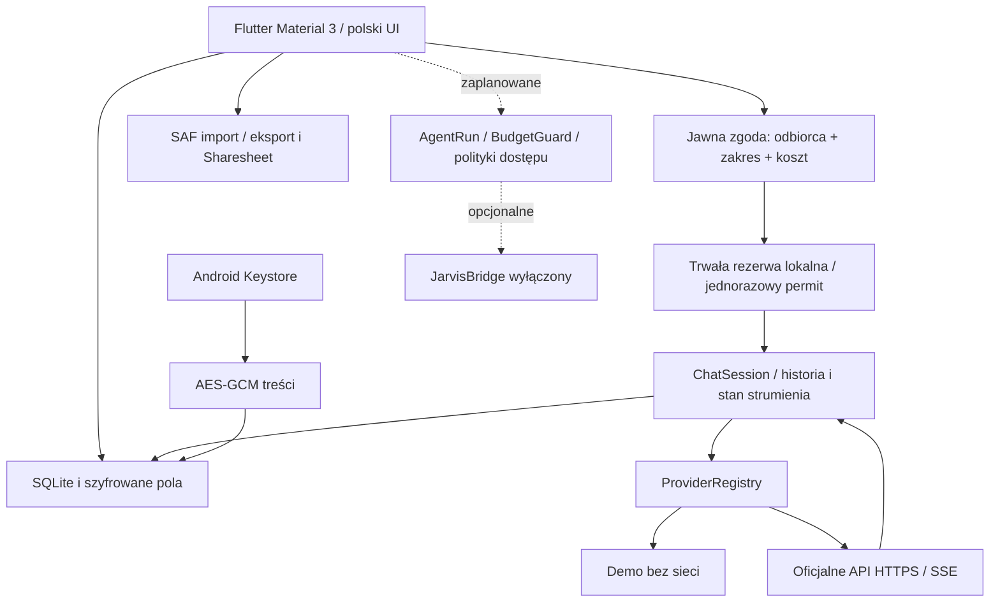

# Architektura Scalającej

Data decyzji: 2026-10-17. Główny produkt to proces Android/Flutter i lokalna baza na telefonie. OPPO nie uczestniczy w uruchamianiu, przechowywaniu danych ani podstawowym czacie.

## Moduły i granice

| Moduł | Odpowiedzialność i stan |
|---|---|
| `ui` | Ekrany, zgody, Material 3, polska lokalizacja, układ skalowalny |
| `chat` | Sesja, streaming, stop, ponawianie do ostatniego user, jawne stany i tryb RAM |
| `provider_registry` | Domenowy kontrakt, demo, cztery transporty HTTP, SSE, katalogi i opisy możliwości |
| `auth` | SecretStore i Android Keystore; SSO jest interfejsem rozszerzeń w registry |
| `storage` | Baza v2, migracje, transakcje, szyfrowanie pól, snapshot/import/export |
| `memory` | Obecnie ręczne notatki w storage/UI; retrieval i wersjonowane rekordy zaplanowane |
| `costs` | Trwały gate czatu i testowany domenowy BudgetGuard dla przyszłych agentów |
| `agents` | Plany, stany, korekty i role domenowe; brak podłączenia do wykonawcy LLM |
| `tasks` | Obecnie lista SQLite i kolejka odnośników do szkiców; harmonogram zaplanowany |
| `security` | Polityka dostępu fail-closed, backup, role i granice widoczności |
| `rpg` | Odizolowane kampanie, manifest i dziennik domenowy; brak gry/UI/importu Fio |
| `optional_jarvis_bridge` | Kontrakt i wyłączona implementacja; parowanie/transport niewdrożone |
| `orchestrator`, `tools`, `permissions`, `notifications`, `diagnostics` | Interfejsy i plan rozbudowy; brak automatycznych zadań/narzędzi zewnętrznych |

Stan UI: lokalne `StatefulWidget` i `ChangeNotifier` bez globalnego frameworka (ADR 001). Stan trwały wyłącznie przez repozytorium. Nawigacja: systemowy Navigator i 5 dolnych zakładek. Polskie teksty są obecnie w widgetach; pełne ARB/i18n to jawne zadanie następnego etapu.

## Dane

`Conversation(id,title,draft,updated,pinned)` → wiele `Message(id,role,text,provider,model,status,usage)`. `LocalNote(id,title,text,folder,updated)` i `tasks` są lokalne. `operations` przechowuje odnośnik, status, liczbę prób i unikalny klucz deduplikacji. `settings` nigdy nie przechowuje klucza API. `cost_reservations` utrzymuje konserwatywne rezerwy po restarcie.

Migracja v1 tworzy rozmowy, wiadomości, ustawienia i notatki; v2 dodaje kolejkę, zadania i rezerwy. Realny kod migracji jest w `AppDatabase.createV1/migrateV2`. Włączone są klucze obce i WAL. Import kopii odbywa się jako jedna transakcja dopisująca rekordy z nowymi ID; błąd walidacji wycofuje całość. Zwykły import nigdy nie nadaje roli systemowej.

Po awarii rekordy `streaming/running` stają się `interrupted`. Żadna płatna operacja nie jest automatycznie odtwarzana. Treść częściowa jest utrwalana co około sekundę i na zakończenie. Szkice są serializowane; wysłanie czeka na zakończenie zapisów. Kolejka nie jest obietnicą działania 24/7 i nie uruchamia automatycznie generacji. Brak synchronizacji oznacza brak obecnie aktywnych konfliktów między urządzeniami. Plan: rewizje, optimistic concurrency, jawne konflikty i tombstones przed włączeniem synchronizacji.

## Prywatność i przyszły retrieval

W zwykłym czacie wysyłamy wyłącznie wiadomości użytkownika i ukończone odpowiedzi tej sesji; nigdy cały vault, inne czaty i notatki. Porównanie wysyła tylko jeden jawny prompt do wskazanych odbiorców, bez przesyłania odpowiedzi między nimi. Nieznana cena blokuje realne API do konfiguracji. Modele nie wykonują narzędzi. Treści źródeł pozostają danymi. Obrazy Markdown nie są pobierane automatycznie.

Przyszły retrieval wymaga rekordów z właścicielem/projektem/kampanią/widocznością/zatwierdzeniem i kontroli przed indeksowaniem, pobraniem, eksportem oraz konstrukcją promptu. `GM_SECRET` jest blokowane w celach gracza, recenzenta, indeksowania i eksportu w domenowej polityce. Ten silnik nie jest jeszcze połączony z normalnymi notatkami, dlatego sekrety RPG nie mogą być importowane jako zwykła pamięć.

## Opcjonalne usługi

Backend ma sens wyłącznie dla webhooków, pracy 24/7, wieloużytkownikowych sekretów, synchronizacji lub JARVIS. Nie ma obowiązkowego backendu. Nie ma przeglądarki z sesją dostawcy, headless automatyzacji jego UI ani serwera Python na telefonie. Parametry dostawcy są niezależne, błąd pojedynczego adaptera nie zatrzymuje pozostałych odpowiedzi porównania.
