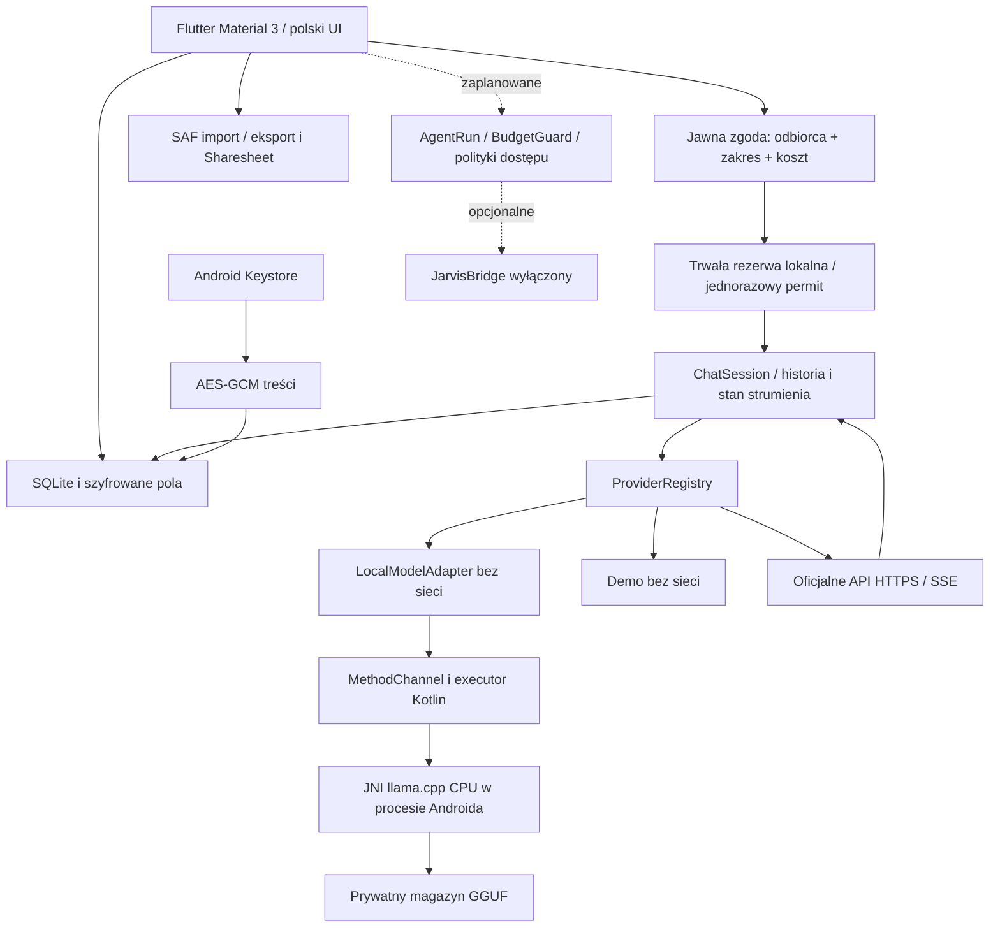

# Architektura Scalającej

Aktualizacja 0.3.0 (19.10.2026): `VaultBridge` → lokalny SAF → `VaultImporter` → szyfrowane wersje/fragmenty SQLite v3 → indeks słów HMAC → zatwierdzony `ContextPacket`. Osobny `CampaignStore` przechowuje kanon/encje/wiedzę gracza/checkpointy i audyt. `ChatSession.prepare` zamraża ograniczoną historię i źródła; zgoda jest związana z digestem, a dispatch sprawdza aktualność i zakres. Rozmowy MG i gracza nie dzielą historii. Import ma trwały checkpoint po pliku; stan analizy jest ręcznie zatwierdzany. Instrukcja i granice: `docs/OBSIDIAN_PAMIEC_RPG_PL.md`, ADR 008. Synchronizacja i automatyczne orkiestracje pozostają zaplanowane.

Aktualizacja 0.2.1 (18.10.2026): `local_inference` jest wdrożonym osobnym modułem. `LocalModelAdapter` → `AndroidLocalEngine` → MethodChannel → Kotlin executor → JNI → przypięte llama.cpp/ggml CPU. Prywatny magazyn GGUF i jego metadane są plikowe, wybór hasha/kontekstu jest ustawieniem SQLite. Jedna operacja silnika w procesie, brak sieci i fallbacku, limity zasobów i anulowanie w tle. Rdzeń C++ jest wspólny z testem rzeczywistych wag na hoście. APK ma ARM64 i x86_64. Generację JNI sprawdzono na emulatorze Android 11 x86_64; fizyczny telefon wymaga osobnego odbioru. Zobacz ADR 006/007 oraz `docs/MINICPM_PL.md`.

`MiniCpmAdapter` z 0.1.1 pozostaje osobnym opcjonalnym klientem własnego serwera HTTPS; `CostStore` nadal rozdziela politykę kosztów i SQLite. Lokalna generacja ma koszt API 0 i permit związany z hashem, bez znoszenia blokad innych dostawców.

Data decyzji: 2026-10-17. Główny produkt to proces Android/Flutter i lokalna baza na telefonie. OPPO nie uczestniczy w uruchamianiu, przechowywaniu danych ani podstawowym czacie.

## Moduły i granice

| Moduł | Odpowiedzialność i stan |
|---|---|
| `ui` | Ekrany, zgody, Material 3, polska lokalizacja, układ skalowalny |
| `chat` | Sesja, streaming, stop, ponawianie do ostatniego user, jawne stany i tryb RAM |
| `provider_registry` | Domenowy kontrakt, demo, cztery transporty HTTP, SSE, katalogi i opisy możliwości |
| `local_inference` | Adapter offline, kanał, zarządzanie modelami, CPU/JNI i bezpieczne błędy; odbiór urządzenia otwarty |
| `auth` | SecretStore i Android Keystore; SSO jest interfejsem rozszerzeń w registry |
| `storage` | Baza v3, migracje v1/v2→v3, transakcje, szyfrowanie pól; klasyczny snapshot zwykłych czatów/notatek/zadań |
| `memory` | Lokalny SAF, wznawialny import, wersje i zatwierdzenia, indeks słów HMAC, ograniczony retrieval, checkpointy analiz |
| `costs` | Trwały gate czatu i testowany domenowy BudgetGuard dla przyszłych agentów |
| `agents` | Plany, stany, korekty i role domenowe; brak podłączenia do wykonawcy LLM |
| `tasks` | Obecnie lista SQLite i kolejka odnośników do szkiców; harmonogram zaplanowany |
| `security` | Polityka dostępu fail-closed, backup, role i granice widoczności |
| `rpg` | UI własnych kampanii, zaszyfrowany kanon/stan świata/wiedza gracza, checkpoint i dopisywany audyt/cofanie; pełna mechanika i import Fio zaplanowane |
| `optional_jarvis_bridge` | Kontrakt i wyłączona implementacja; parowanie/transport niewdrożone |
| `orchestrator`, `tools`, `permissions`, `notifications`, `diagnostics` | Interfejsy i plan rozbudowy; brak automatycznych zadań/narzędzi zewnętrznych |

Stan UI: lokalne `StatefulWidget` i `ChangeNotifier` bez globalnego frameworka (ADR 001). Stan trwały wyłącznie przez repozytorium. Nawigacja: systemowy Navigator i 5 dolnych zakładek. Polskie teksty są obecnie w widgetach; pełne ARB/i18n to jawne zadanie następnego etapu.

## Dane

`Conversation(id,title,draft,updated,pinned)` → wiele `Message(id,role,text,provider,model,status,usage)`. `LocalNote(id,title,text,folder,updated)` i `tasks` są lokalne. `operations` przechowuje odnośnik, status, liczbę prób i unikalny klucz deduplikacji. `settings` nigdy nie przechowuje klucza API. `cost_reservations` utrzymuje konserwatywne rezerwy po restarcie.

Migracja v1 tworzy rozmowy, wiadomości, ustawienia i notatki; v2 dodaje kolejkę, zadania i rezerwy. Wersja v3 dodaje wersje i fragmenty pamięci, indeks HMAC, checkpointy analiz, zakresy i dowody kontekstu czatu oraz trwały agregat kampanii. Kod migracji jest w `AppDatabase.createV1/migrateV2/migrateV3`. Włączone są klucze obce i WAL. Import kopii odbywa się jako jedna transakcja dopisująca rekordy z nowymi ID; błąd walidacji wycofuje całość. Zwykły import nigdy nie nadaje roli systemowej.

Po awarii rekordy `streaming/running` stają się `interrupted`. Żadna płatna operacja nie jest automatycznie odtwarzana. Treść częściowa jest utrwalana co około sekundę i na zakończenie. Szkice są serializowane; wysłanie czeka na zakończenie zapisów. Kolejka nie jest obietnicą działania 24/7 i nie uruchamia automatycznie generacji. Brak synchronizacji oznacza brak obecnie aktywnych konfliktów między urządzeniami. Plan: rewizje, optimistic concurrency, jawne konflikty i tombstones przed włączeniem synchronizacji.

## Prywatność i retrieval

W zwykłym czacie wysyłamy wyłącznie wiadomości użytkownika i ukończone odpowiedzi tej sesji; nigdy cały vault, inne czaty i notatki. Porównanie wysyła tylko jeden jawny prompt do wskazanych odbiorców, bez przesyłania odpowiedzi między nimi. Nieznana cena blokuje realne API do konfiguracji. Modele nie wykonują narzędzi. Treści źródeł pozostają danymi. Obrazy Markdown nie są pobierane automatycznie.

Retrieval 0.3.0 używa zatwierdzonych wersji dokumentów z właścicielem i kolekcją. Kontrola SQL poprzedza ranking i odszyfrowanie; walidacja poprzedza eksport i dispatch. Ogólne źródła RPG/GM_SECRET są wyłączone z indeksu. Osobny CampaignStore sprawdza kampanię, rolę i cel, bez indeksowania sekretów. Zwykłe ręczne LocalNote pozostają osobną prostą funkcją, bez automatycznego dołączania do promptu. Semantyczny indeks i integracja agentów są zaplanowane.

## Opcjonalne usługi

Backend ma sens wyłącznie dla webhooków, pracy 24/7, wieloużytkownikowych sekretów, synchronizacji lub JARVIS. Nie ma obowiązkowego backendu. Nie ma przeglądarki z sesją dostawcy, headless automatyzacji jego UI ani serwera Python na telefonie. Parametry dostawcy są niezależne, błąd pojedynczego adaptera nie zatrzymuje pozostałych odpowiedzi porównania.
